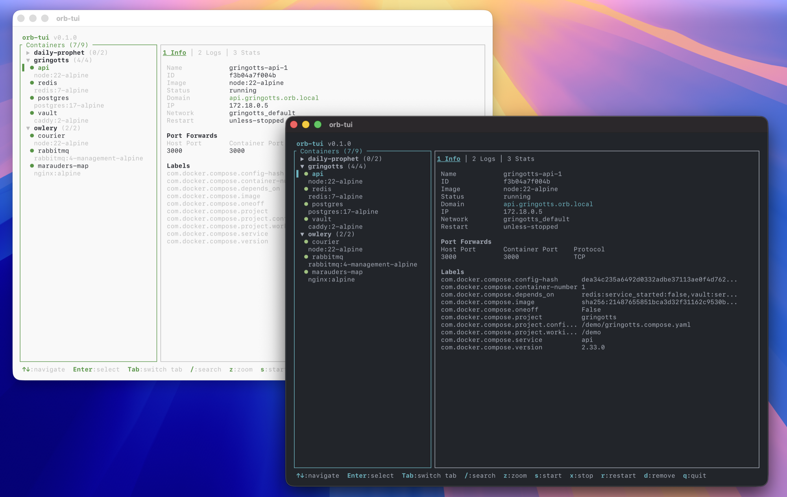

# orb-tui

A terminal UI for managing your OrbStack containers.

It's built around OrbStack, but it talks to the plain `docker` CLI, so the core features work with any Docker runtime (Docker Desktop, colima, etc.). The OrbStack extras (launch prompt, `.orb.local` domains) only kick in when OrbStack is there.

> **Note:** This project is in early development (v0.1). It works, but expect rough edges.



## Why

Managing containers from the command line means juggling `docker ps`, `docker logs`, `docker stats`, and `docker inspect` over and over. `orb-tui` puts all of that on one screen so you can see what's happening without switching between commands.

## Features

- Container dashboard that refreshes every 5 seconds
- Start, stop, restart, and remove containers
- Inspect, logs, and resource stats in a tabbed detail view
- Docker Compose project grouping with collapsible groups
- Group actions (start/stop/restart/remove all containers in a project)
- Inactive groups collapse automatically
- Fullscreen detail view
- Live search by container, image, service, or project name
- Vim-style navigation
- OrbStack integration (auto-detect, launch prompt, `.orb.local` domains)

## Requirements

- macOS (tested). Linux should work since everything goes through the `docker` CLI, but it hasn't been tested yet
- `docker` CLI on your PATH
- Rust 1.88 or newer to build it
- A Docker runtime ([OrbStack](https://orbstack.dev/), Docker Desktop, colima, etc.)

## Installation

```sh
cargo install --git https://github.com/villads-valur/orb-tui
```

This puts `orb-tui` in `~/.cargo/bin`, which should already be on your PATH if you installed Rust with rustup.

### From a local clone

```sh
git clone https://github.com/villads-valur/orb-tui.git
cd orb-tui
cargo install --path .
```

## Usage

```sh
orb-tui
```

That's it.

## Keybindings

### Navigation

| Key | Action |
|-----|--------|
| `j` / `Down` | Move down (scrolls when the detail panel is focused) |
| `k` / `Up` | Move up (scrolls when the detail panel is focused) |
| `Enter` / `l` / `Right` | Expand/collapse group, or focus detail panel |
| `h` / `Left` | Back to container list, or leave fullscreen |
| `Tab` | Next tab |
| `Shift+Tab` | Previous tab |
| `1` `2` `3` | Jump to Info / Logs / Stats tab |
| `g` | Scroll detail panel to top |
| `G` | Scroll detail panel to bottom (turns log follow back on) |
| `Ctrl+u` | Scroll detail panel half a page up |
| `Ctrl+d` | Scroll detail panel half a page down |

### Container Actions

| Key | Action |
|-----|--------|
| `s` | Start container (or all in group) |
| `x` | Stop container (or all in group) |
| `r` | Restart container (or all in group) |
| `d` | Remove container (or all in group, asks for confirmation) |
| `f` | Toggle log follow mode |
| `z` | Toggle fullscreen detail view |
| `o` | Open OrbStack (when Docker is unavailable) |

### Search

| Key | Action |
|-----|--------|
| `/` | Start searching |
| `Enter` | Confirm filter |
| `Esc` | Cancel search |

The list filters as you type.

### Confirm Prompt

| Key | Action |
|-----|--------|
| `y` / `Enter` | Confirm |
| `n` / `Esc` | Cancel |

### General

| Key | Action |
|-----|--------|
| `q` / `Ctrl+c` | Quit |
| `Esc` | Leave fullscreen, clear filter, or unfocus detail panel |

## Known Limitations

- Only tested on macOS. The OrbStack launcher (`o`) uses the macOS `open` command
- No config file yet
- No custom keybinding remapping
- Early days, things will change

## Contributing

This project is very young and there's a lot of room for improvement. If something bugs you or you have an idea, open an issue. Pull requests are welcome too.

Some areas that could use help:

- Testing on Linux and Windows
- Configuration file for custom keybindings and settings
- Better error handling and edge cases
- Tests

## Built With

- [Rust](https://www.rust-lang.org/)
- [ratatui](https://github.com/ratatui/ratatui) - TUI framework
- [crossterm](https://github.com/crossterm-rs/crossterm) - Terminal backend

## License

[MIT](LICENSE)
